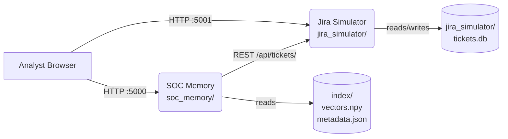

# SOC Memory

> **Intelligent historical-incident retrieval and investigation assistant for Security Operations Centre (SOC) analysts.**

SOC Memory lets an analyst paste a free-text incident description (or load a live ticket straight from the built-in Jira Simulator) and instantly surfaces the most similar historical cases — with shared IOCs, top resolution playbooks, and near-duplicate flags.

---

## Architecture

```
┌─────────────────────────────────────────────────────────────────┐
│                         Analyst Browser                         │
└────────────────────┬─────────────────────┬──────────────────────┘
                     │  HTTP :5000          │  HTTP :5001
          ┌──────────▼──────────┐  ┌────────▼────────────┐
          │   SOC Memory App    │  │  Jira Simulator App  │
          │  (soc_memory/)      │  │  (jira_simulator/)   │
          │                     │  │                      │
          │  Flask + Jinja2     │  │  Flask + SQLite      │
          │  NumPy cosine index │  │  Full CRUD UI + REST │
          │  sentence-xformers  │  │  /api/tickets/       │
          └──────────┬──────────┘  └────────────────────--┘
                     │  REST API only (no direct DB / import)
                     └──────────────────────────────────────▶ /api/tickets/
```



The two services are **strictly decoupled**: `soc_memory` communicates with `jira_simulator` only through its REST API — never by importing its modules or reading its database.

---

## Features

| Feature | Detail |
|---|---|
| **Free-text analysis** | Paste any incident text; IOCs are auto-extracted and embedded |
| **Load from Jira** | Pick a live ticket from the Jira Simulator UI |
| **Similarity search** | `all-MiniLM-L6-v2` + NumPy cosine similarity; top-10 historical matches |
| **Shared-IOC highlighting** | Lists IOCs that appear in both the query and matched incidents |
| **Top resolutions** | Surfaces up to 3 resolution playbooks from the closest matches |
| **Duplicate detection** | Flags tickets with cosine score ≥ 0.92 |
| **Jira Simulator** | Standalone ticketing app: create / view / resolve tickets, severity badges, IOC pills |
| **Seed dataset** | 50 curated synthetic incidents, 8 attack archetypes, RFC-5737 safe IPs |

---

## Project Layout

```
IBM-Bob-Hackathon-2026/
├── soc_memory/              # Main application (port 5000)
│   ├── app.py               # Flask app factory (create_app)
│   ├── routes.py            # GET /health, GET /, POST /analyze, GET /incidents/<id>
│   ├── models.py            # Pydantic v2: Incident, IOC, Severity, Status
│   ├── ioc_extractor.py     # Regex-based IOC extraction (IPv4, domain, URL, hash)
│   ├── embedder.py          # sentence-transformers wrapper (all-MiniLM-L6-v2)
│   ├── index_manager.py     # NumPy vector index: build / save / load / search
│   ├── synthesizer.py       # Deterministic synthesis: shared IOCs, resolutions, duplicates
│   ├── connector.py         # JiraSimulatorConnector — REST API client
│   └── templates/           # Jinja2 templates (Bootstrap 5)
│       ├── base.html
│       ├── index.html
│       ├── results.html
│       ├── incident_detail.html
│       └── 404.html
├── jira_simulator/          # Standalone ticketing app (port 5001)
│   ├── app.py               # Flask app factory
│   ├── models.py            # SQLAlchemy Ticket model
│   ├── routes.py            # UI routes + /api/tickets/ REST endpoints
│   └── templates/           # Jinja2 templates (Bootstrap 5)
│       ├── base.html
│       ├── tickets.html
│       ├── ticket_detail.html
│       ├── ticket_create.html
│       └── 404.html
├── data/
│   └── seed_incidents.json  # 50 synthetic incidents (8 archetypes)
├── index/                   # Auto-generated by seed.py
│   ├── vectors.npy          # (50, 384) float32 embedding matrix
│   └── metadata.json        # Incident metadata parallel to vectors
├── tests/
│   ├── test_synthesizer.py  # 8 unit tests for DeterministicSummarizer
│   ├── test_connector.py    # 12 unit tests for JiraSimulatorConnector (mocked HTTP)
│   └── test_routes.py       # 15 Flask test-client tests for SOC Memory routes
├── seed.py                  # Builds index/ from data/seed_incidents.json
├── run_jira.py              # Start Jira Simulator on port 5001
├── run_soc.py               # Start SOC Memory on port 5000
├── requirements.txt
├── .env.example
└── AGENTS.md                # Project rules & known gotchas
```

---

## Quickstart

### 1 · Prerequisites

- Python 3.11+
- Recommended: Conda environment (`bobpyenv`) or any virtualenv

### 2 · Install dependencies

```bash
pip install -r requirements.txt
```

> **First-run note:** `sentence-transformers` will download the `all-MiniLM-L6-v2` model (~80 MB) on the very first call to `seed.py` or `run_soc.py`. Subsequent starts are instant.

### 3 · Configure environment (optional)

```bash
cp .env.example .env
# Edit .env to set SOC_MEMORY_SECRET_KEY, JIRA_BASE_URL, etc.
```

### 4 · Build the vector index

```bash
python seed.py
```

This reads `data/seed_incidents.json`, embeds all 50 incidents, and writes `index/vectors.npy` + `index/metadata.json`.

### 5 · Start both servers

Open **two terminals**:

**Terminal 1 — Jira Simulator (port 5001)**

```bash
python run_jira.py
```

**Terminal 2 — SOC Memory (port 5000)**

```bash
python run_soc.py
```

### 6 · Use the analyst UI

| URL | Purpose |
|-----|---------|
| `http://localhost:5000/` | SOC Memory analyst home |
| `http://localhost:5000/health` | Health check + index size |
| `http://localhost:5001/` | Jira Simulator ticket board |
| `http://localhost:5001/api/tickets/` | JSON REST endpoint |

**Typical workflow:**

1. Open the Jira Simulator (`http://localhost:5001`) and create a new ticket describing a security incident.
2. In SOC Memory (`http://localhost:5000`), either:
   - paste the incident text directly into the **Free-text analysis** box, or
   - select the ticket from the **Load from Jira** dropdown and click **Analyse**.
3. The results page shows the top-10 historical matches, shared IOCs, recommended resolutions, and any near-duplicate flags.

---

## Running the Test Suite

```bash
python -m pytest tests/ -v
```

Expected: **35 tests pass** (`test_synthesizer.py` × 8, `test_connector.py` × 12, `test_routes.py` × 15).

> `test_synthesizer.py` requires `index/` to exist (run `seed.py` first). The route and connector tests are fully mocked and run offline.

---

## Configuration Reference (`.env`)

| Variable | Default | Purpose |
|---|---|---|
| `SOC_MEMORY_SECRET_KEY` | `soc-memory-dev-secret` | Flask session secret |
| `JIRA_BASE_URL` | `http://localhost:5001` | Jira Simulator base URL |
| `JIRA_API_TOKEN` | *(none)* | Optional bearer token for the REST API |

---

## Stack

| Layer | Technology |
|---|---|
| Web framework | Flask 3.x + Jinja2 |
| Data validation | Pydantic v2 |
| Embedding model | `all-MiniLM-L6-v2` via `sentence-transformers` |
| Vector index | NumPy cosine similarity (FAISS optional) |
| Ticket database | SQLite via Flask-SQLAlchemy |
| Testing | pytest |

---

## Known Limitations / Gotchas

- **Windows Conda interpreter:** Always invoke `C:\ProgramData\Anaconda3\envs\bobpyenv\python.exe` directly in scripts; bare `python` may not resolve in non-activated sub-shells.
- **FAISS on Windows:** The `faiss-cpu` wheel is not pre-installed. The index manager falls back to NumPy automatically — no action needed unless you need FAISS performance.
- **Model download on first run:** `all-MiniLM-L6-v2` (~80 MB) is fetched from HuggingFace Hub on the first `seed.py` execution. Ensure internet access for the initial setup.
- **Static index:** The vector index is built once by `seed.py`. Re-run `seed.py` after adding new incidents to `data/seed_incidents.json`.
