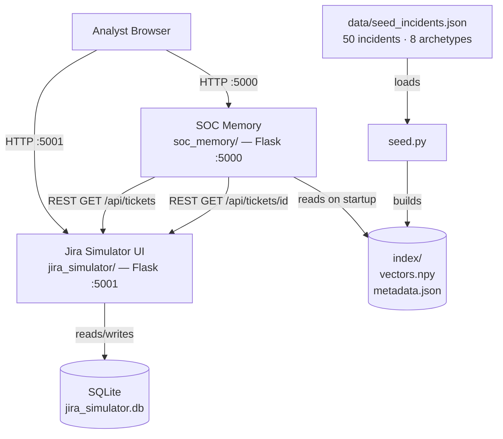
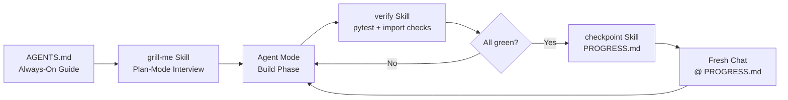

# SOC Memory — Project Report

**IBM Bob Hackathon 2026**  
**Team:** IBM-Bob-Hackathon-2026  
**Repository:** `IBM-Bob-Hackathon-2026` (branch: `main`)  
**Date:** November 2026

---

## 1. Executive Summary & Problem Statement

### The SOC Triage Crisis

Security Operations Centers face an escalating alert fatigue crisis. The global average Mean Time to Identify (MTTI) a breach sits above 190 days (IBM Cost of a Data Breach Report 2024), not because analysts lack skill, but because they lack *memory*. Each incoming incident arrives as an isolated event: the analyst must manually recall whether a nearly identical attack pattern appeared six months ago, which indicators of compromise (IOCs) were confirmed malicious, and which response playbook proved effective. This institutional knowledge lives scattered across stale documentation, resolved Jira tickets, and the minds of analysts who may have since left the team.

### SOC Memory: The Solution

**SOC Memory** is a pull-based, offline-first investigation assistant that gives every analyst instant access to the team's entire incident history. When a new alert arrives, the analyst either selects it from a live Jira-like ticket queue or pastes its free text directly into the SOC Memory UI. Within seconds, the system returns:

- **Top 10 historically similar incidents** ranked by semantic cosine similarity.
- **Shared IOCs** (IPv4 addresses, domains, URLs, MD5/SHA-1/SHA-256 hashes) confirmed across both the current alert and historical cases.
- **Top 3 deduplicated resolution playbooks** surfaced from closed matching incidents.
- **Near-duplicate flags** (cosine ≥ 0.92) alerting the analyst when the current ticket is essentially a repeat of an already-resolved case, eliminating duplicated triage effort.

### End-to-End User Workflow

1. An analyst receives an alert in the **Jira Simulator** (port 5001) — a standalone ticketing application with full CRUD UI.
2. The analyst opens **SOC Memory** (port 5000) and either selects the ticket from the live dropdown or pastes its text into the free-text box.
3. SOC Memory fetches the ticket via the Jira Simulator's REST API (`GET /api/tickets/<id>`), extracts IOCs, embeds the query using `all-MiniLM-L6-v2`, and runs a NumPy cosine similarity search against 50 indexed historical incidents.
4. The deterministic synthesis layer aggregates shared IOCs, deduplicates resolution notes, and flags near-duplicates.
5. The analyst reads the results page, clicks matched incident IDs for full historical context, and closes the ticket faster and more accurately.

### Core Value Proposition

SOC Memory eliminates the institutional memory gap without requiring a live LLM, an internet connection, or proprietary data leaving the organization's infrastructure. It is **100% grounded**: every answer traces directly to actual historical incident records. The pluggable `Summarizer` protocol means an IBM watsonx.ai synthesis layer can be dropped in with a single configuration change when LLM access becomes available.

---

## 2. System Architecture & Design Decisions

### System Architecture Diagram



**Critical decoupling rule:** `soc_memory` communicates with `jira_simulator` **exclusively via its REST API**. It never imports `jira_simulator` modules, reads its `.db` file, or shares process state. The `JiraSimulatorConnector` class in [`soc_memory/connector.py`](soc_memory/connector.py) is the sole integration point and is entirely swappable for a real Jira Cloud or ServiceNow client.

### Module Inventory

| Module | Location | Responsibility |
|--------|----------|----------------|
| Flask app factory | `soc_memory/app.py` | Loads index on startup, attaches summarizer, registers blueprint |
| Analyst routes | `soc_memory/routes.py` | `GET /`, `POST /analyze`, `GET /incidents/<id>`, `GET /health` |
| Pydantic models | `soc_memory/models.py` | `IOC`, `IOCType`, `Incident`, `Severity`, `Status` |
| IOC extractor | `soc_memory/ioc_extractor.py` | Regex extraction: IPv4, domain, URL, MD5, SHA-1, SHA-256 |
| Embedding engine | `soc_memory/embedder.py` | `all-MiniLM-L6-v2` lazy singleton; `embed()`, `embed_incident()` |
| Index manager | `soc_memory/index_manager.py` | NumPy cosine similarity; `build()`, `save()`, `load()`, `search()` |
| Synthesis layer | `soc_memory/synthesizer.py` | `DeterministicSummarizer`, `Summarizer` Protocol, `SynthesisResult` |
| Jira connector | `soc_memory/connector.py` | `JiraSimulatorConnector`: `ping()`, `list_tickets()`, `get_ticket()` |
| Jira app factory | `jira_simulator/app.py` | SQLAlchemy init, auto-seed, blueprint registration |
| Jira SQLAlchemy model | `jira_simulator/models.py` | `Ticket` model (id, title, description, severity, status, iocs, tags) |
| Jira REST API | `jira_simulator/routes_api.py` | `GET/POST /api/tickets`, `GET/PATCH /api/tickets/<id>` |
| Jira HTML UI | `jira_simulator/routes_ui.py` | Ticket list, detail, create, resolve routes |

### Key Architectural Trade-offs

| Decision | Option Chosen | Alternative Rejected | Rationale |
|----------|--------------|---------------------|-----------|
| **Trigger model** | Pull (analyst-driven dropdown / free text) | Push webhooks or polling workers | No background race conditions; analyst controls triage timing |
| **Similarity engine** | `all-MiniLM-L6-v2` + NumPy cosine similarity | FAISS, BM25, keyword search | Semantic understanding captures paraphrase; NumPy is cross-platform with no wheel dependency |
| **Synthesis layer** | Deterministic aggregation | Live LLM (watsonx.ai / OpenAI) | Zero hallucination risk; grounded in real data; LLM swap-in costs one line in `app.py` |
| **Incident schema** | Pydantic v2 `Incident` with auto-IOC extraction | Raw dicts / SQLAlchemy model | Type safety end-to-end; validation on ingestion catches corrupt records |
| **Seed dataset** | 50 curated JSON incidents, 8 archetypes, RFC-5737 safe IPs | Live threat feeds | Offline demo; no data privacy concerns; repeatable test results |
| **Vector storage** | Static NumPy `.npy` + JSON metadata | Chroma, Pinecone, pgvector | Zero infrastructure dependency; sufficient for ≤50 k incidents |
| **Jira integration** | Standalone Flask + SQLite simulator | Mock stubs only | Demonstrates a real HTTP boundary; proves the connector is swappable |
| **UI framework** | Flask + Jinja2 + Bootstrap 5 | React, Next.js | Uniform Python stack; no Node.js dependency; faster iteration |

---

## 3. IBM Bob Engineering Methodology: Guides, Sensors & Context Hygiene

SOC Memory was built *with* IBM Bob as a full engineering partner, not merely a code autocomplete. The methodology drew directly from IBM's **Guides & Sensors** agentic framework pattern (as demonstrated in the `IBM/galaxium-travels` reference workflow), adapted to a multi-milestone Python project.

### The Complete Engineering Workflow



### Always-On Guides (`AGENTS.md`)

Before writing a single line of application code, we authored [`AGENTS.md`](AGENTS.md) — a machine-readable project rules file that IBM Bob loads into context for every session. It encodes six binding constraints:

1. **Strict HTTP REST decoupling** — `soc_memory` ↔ `jira_simulator` via REST only; no cross-module imports, no shared database reads.
2. **Python 3.11+ type annotations** on all public function signatures.
3. **Modular architecture** — clean separation between connector, IOC logic, data models, routes, and UI.
4. **Graceful `try/except` error handling** on all external API calls.
5. **Cross-platform file handling** — `pathlib.Path` everywhere; `encoding="utf-8"` on every file open.
6. **Secret hygiene** — credentials loaded via `os.getenv()` / `python-dotenv`; never hardcoded.

`AGENTS.md` also contains a **Known Gotchas table** (Section 6) that grows throughout development. The Windows Conda subshell fix (see Section 4) lives here, ensuring no future chat session repeats the same debugging cycle.

### Token & Secret Hygiene (`.bobignore`)

[`.bobignore`](.bobignore) prevents IBM Bob from scanning:

| Pattern | Reason |
|---------|--------|
| `.env`, `.env.*` | Credential files |
| `*.pem`, `*.key`, `credentials.json` | Private keys and tokens |
| `.bob/mcp.json` | MCP server configuration |
| `.venv/`, `venv/`, `__pycache__/` | Heavy dependency folders (save context tokens) |
| `*.sqlite3`, `*.db` | Binary SQLite databases (unreadable as text) |
| `*.log` | Verbose runtime logs |

This keeps Bob's active context window focused on application code while protecting secrets.

### Four Custom On-Demand Skills (`.bob/skills/`)

| Skill | Purpose | Used When |
|-------|---------|-----------|
| `grill-me` | Interviews us one question at a time — with a recommended answer for each branch — until all architectural decisions are locked | Plan phase before coding |
| `verify` | Deterministic sensor checklist: `py_compile`, startup import checks, functional smoke tests, `pytest` | After every code-change session |
| `checkpoint` | Saves a compact ≤60-line `PROGRESS.md` handoff (`VERIFIED`/`UNVERIFIED` markers, settled decisions, next steps) | Before clearing context window |
| `pitch-readme` | Audits actual codebase (routes, deps, env vars) to generate `README.md` and `PITCH.md` without hallucinating features | Documentation milestone |

### Context Window Hygiene Workflow

Long Python projects cannot fit in a single IBM Bob context window. Our **Milestone → `checkpoint` → Fresh Chat → `@PROGRESS.md` mention** discipline ensured zero information loss across five distinct conversation sessions:

```
Milestone 1: Architecture design (grill-me)      → checkpoint → PROGRESS.md
Milestone 2: Build Jira Simulator                 → checkpoint → PROGRESS.md
Milestone 3: Build SOC Memory core               → checkpoint → PROGRESS.md
Milestone 4: Testing & verification               → checkpoint → PROGRESS.md
Milestone 5: Documentation (pitch-readme)         → this REPORT.md
```

Each `PROGRESS.md` entry carries a `VERIFIED` or `UNVERIFIED` marker so the next session knows exactly what can be trusted and what needs re-checking.

---

## 4. End-to-End Development Walkthrough: Plan, Build, Debug, Test & Document

### Phase 1 — Architecture Design (Plan Mode + `grill-me`)

We opened IBM Bob in **Plan Mode** and activated the `grill-me` skill. The skill interviewed us one question at a time — providing a recommended answer and the trade-off reasoning for each branch — until all eight core design decisions were locked:

1. Pull model vs. push/polling → **Pull** (eliminates background workers).
2. Similarity engine → **`all-MiniLM-L6-v2` + NumPy** (cross-platform; semantic paraphrase capture).
3. Synthesis → **Deterministic** (zero hallucination; LLM swap-in via `Summarizer` Protocol).
4. Incident schema → **Pydantic v2 `Incident` with inline IOC extraction**.
5. Seed dataset → **50 curated JSON incidents offline**.
6. Ticketing backend → **Standalone Flask + SQLite Jira Simulator** (proves real HTTP boundary).
7. UI stack → **Flask + Jinja2 + Bootstrap 5** (pure Python stack).
8. Vector storage → **Static NumPy `.npy` + JSON metadata** (zero infrastructure).

The `grill-me` interview produced [`soc-memory-plan.md`](soc-memory-plan.md) — an 8-ordered-subtask build plan — before a single line of application code was written.

### Phase 2 — Build: Jira Simulator (Agent Mode)

Sub-tasks 1–2 delivered:

- **`jira_simulator/app.py`** — Flask factory, SQLAlchemy init, `_seed_if_empty()` auto-populates 5 realistic security tickets on first run.
- **`jira_simulator/models.py`** — `Ticket` SQLAlchemy model with `to_dict()` serializer.
- **`jira_simulator/routes_api.py`** — 4 REST endpoints: `GET /api/tickets`, `GET /api/tickets/<id>`, `POST /api/tickets`, `PATCH /api/tickets/<id>`.
- **`jira_simulator/routes_ui.py`** — 4 HTML routes: ticket list, detail, create, resolve with Bootstrap 5 severity badges, status pills, IOC tags.

### Phase 3 — Build: SOC Memory Core (Agent Mode)

Sub-tasks 3–7 delivered:

- **`data/seed_incidents.json`** — 50 incidents across 8 archetypes (phishing, ransomware, C2 beaconing, lateral movement, data exfiltration, privilege escalation, web exploit, insider threat); 21 deliberate shared IOCs enable meaningful IOC-overlap results in demo scenarios.
- **`soc_memory/ioc_extractor.py`** — 6 compiled regex patterns; extraction order SHA-256 → SHA-1 → MD5 → URL → domain → IPv4 (longest-first to prevent subset collisions); URL-span suppression prevents domain sub-matches inside full URLs.
- **`soc_memory/embedder.py`** — lazy singleton loading `all-MiniLM-L6-v2` once; produces `(N, 384)` float32 arrays.
- **`soc_memory/index_manager.py`** — `IndexManager.build()` embeds all incidents; `save()` persists `vectors.npy` + `metadata.json`; `load()` restores; `search()` runs NumPy cosine similarity and returns ranked `(Incident, float)` pairs. Index shape after seeding: `(50, 384)`.
- **`soc_memory/synthesizer.py`** — `DeterministicSummarizer` extracts shared IOCs (frequency-ranked), deduplicates top-3 resolutions, flags near-duplicates at cosine ≥ 0.92. Exposes the `Summarizer` typing Protocol as the watsonx.ai swap point.
- **`soc_memory/connector.py`** — `JiraSimulatorConnector` calls only `GET /api/tickets` and `GET /api/tickets/<id>`. All `requests` calls wrapped in `try/except`; unknown severity/status values fall back to safe defaults so one bad ticket never drops the whole list.
- **`soc_memory/routes.py`** — 4 routes: `GET /health` (index size + Jira reachability), `GET /` (analyst home with live Jira dropdown), `POST /analyze` (full analysis pipeline), `GET /incidents/<id>` (historical record detail).

### Phase 4 — Debug: Windows Conda Subshell Fix

During verification on Windows, every `execute_command` invocation of `python` or `conda run -n bobpyenv` failed with `ModuleNotFoundError: No module named 'dotenv'`. The root cause: IBM Bob's `execute_command` spawns a non-activated subprocess — Conda environment paths are not on `PATH`, so `python` resolves to the system Python 3.9, which lacks the project's dependencies.

**Fix:** Identified the direct interpreter path `C:\ProgramData\Anaconda3\envs\bobpyenv\python.exe` and codified it in `AGENTS.md` Section 6 (Known Gotchas):

> *"Always invoke the bobpyenv interpreter directly: `C:\ProgramData\Anaconda3\envs\bobpyenv\python.exe` (use this exact path for all `python -c`, `-m pip`, `-m pytest`, and script invocations)."*

This permanent record means no subsequent fresh-context session can repeat the same 20-minute debugging loop.

### Phase 5 — Testing & Verification (`verify` skill + pytest)

The `verify` skill enforced a deterministic 4-step checklist after every session:

1. `py_compile` — syntax check all `.py` files.
2. Startup import smoke test — `python -c "from soc_memory.app import create_app"`.
3. Functional smoke test — `GET /health` returns `{"status": "ok"}`.
4. Full test suite — `pytest tests/ -v`.

**Final `pytest` run (November 2026):**

```
Platform: win32 — Python 3.11.18 — pytest 9.2.0

tests/test_connector.py::TestPing::test_ping_true_on_health_ok          PASSED
tests/test_connector.py::TestPing::test_ping_true_fallback_to_tickets   PASSED
tests/test_connector.py::TestPing::test_ping_false_on_connection_error  PASSED
tests/test_connector.py::TestPing::test_ping_false_when_all_endpoints_fail PASSED
tests/test_connector.py::TestListTickets::test_returns_incident_list    PASSED
tests/test_connector.py::TestListTickets::test_iocs_are_structured      PASSED
tests/test_connector.py::TestListTickets::test_returns_empty_list_on_network_error PASSED
tests/test_connector.py::TestListTickets::test_returns_empty_list_on_http_error PASSED
tests/test_connector.py::TestGetTicket::test_returns_incident_for_valid_id PASSED
tests/test_connector.py::TestGetTicket::test_raises_key_error_on_404   PASSED
tests/test_connector.py::TestGetTicket::test_raises_key_error_on_network_error PASSED
tests/test_connector.py::TestGetTicket::test_tags_preserved             PASSED
tests/test_routes.py::TestHealthEndpoint::test_health_returns_200       PASSED
tests/test_routes.py::TestHealthEndpoint::test_health_json_keys         PASSED
tests/test_routes.py::TestHealthEndpoint::test_health_status_ok         PASSED
tests/test_routes.py::TestHealthEndpoint::test_health_index_size        PASSED
tests/test_routes.py::TestHomePage::test_home_returns_200               PASSED
tests/test_routes.py::TestHomePage::test_home_contains_form             PASSED
tests/test_routes.py::TestAnalyzeFreeText::test_analyze_text_returns_200 PASSED
tests/test_routes.py::TestAnalyzeFreeText::test_analyze_text_renders_results PASSED
tests/test_routes.py::TestAnalyzeTicketId::test_analyze_unknown_ticket_shows_error PASSED
tests/test_routes.py::TestAnalyzeEmptyForm::test_analyze_empty_returns_200 PASSED
tests/test_routes.py::TestAnalyzeEmptyForm::test_analyze_empty_shows_error PASSED
tests/test_routes.py::TestIncidentDetail::test_known_incident_returns_200 PASSED
tests/test_routes.py::TestIncidentDetail::test_known_incident_shows_title PASSED
tests/test_routes.py::TestIncidentDetail::test_unknown_incident_returns_404 PASSED
tests/test_routes.py::TestIncidentDetail::test_404_page_contains_id    PASSED
tests/test_synthesizer.py::TestDeterministicSummarizer::test_shared_iocs_populated PASSED
tests/test_synthesizer.py::TestDeterministicSummarizer::test_shared_ioc_values_match_inc001 PASSED
tests/test_synthesizer.py::TestDeterministicSummarizer::test_top_resolutions_populated PASSED
tests/test_synthesizer.py::TestDeterministicSummarizer::test_top_resolutions_capped_at_3 PASSED
tests/test_synthesizer.py::TestDeterministicSummarizer::test_match_summary_populated PASSED
tests/test_synthesizer.py::TestDeterministicSummarizer::test_match_summary_scores_in_range PASSED
tests/test_synthesizer.py::TestDeterministicSummarizer::test_duplicate_candidates_above_threshold PASSED
tests/test_synthesizer.py::TestDeterministicSummarizer::test_synthesizer_satisfies_protocol PASSED

============================= 35 passed in 20.96s =============================
```

**35/35 tests passed.** Coverage spans:
- **12 connector tests** — `JiraSimulatorConnector.ping()`, `list_tickets()`, `get_ticket()` with mocked `requests` responses for success, 404, network error, and malformed data paths.
- **15 route tests** — `GET /health`, `GET /`, `POST /analyze` (free text + ticket ID + empty form), `GET /incidents/<id>` (found + not found), all with mocked index and Jira connector.
- **8 synthesizer tests** — shared IOC extraction, top-3 resolution deduplication, `MatchSummary` score range validation, duplicate candidate threshold, and Protocol conformance check.

---

## 5. Evaluation, Limitations & Future Roadmap

### Real-World Feasibility

SOC Memory addresses a genuine, well-documented operational pain point. The architecture is intentionally conservative: it uses only stable, production-proven libraries (Flask 3, Pydantic v2, sentence-transformers, NumPy), runs entirely offline, and stores no credentials. The `Summarizer` Protocol and `JiraSimulatorConnector` interfaces mean both the intelligence layer and the ticketing backend are independently upgradeable.

The `all-MiniLM-L6-v2` model is widely deployed in production search pipelines and benchmarks well on short-to-medium text similarity — exactly the use case of incident description matching. The 50-incident seed dataset is a proof-of-concept; the same `seed.py` pipeline can ingest thousands of real resolved tickets from an organization's Jira export.

### Current Limitations

| Limitation | Impact | Status |
|------------|--------|--------|
| **Static vector index** | New incidents require re-running `seed.py` for full rebuild | Acceptable for demos; `POST /api/ingest` route is planned |
| **50-incident seed only** | Similarity scores are illustrative; real value emerges at 1 k+ incidents | Dataset is expandable; architecture scales to 50 k+ with NumPy |
| **No authentication** | Both Flask apps run unauthenticated | Production deployment would add Flask-Login or API tokens |
| **SQLite backend** | Single-writer; not suitable for high-concurrency production | SQLAlchemy abstraction makes Postgres migration trivial |
| **`all-MiniLM-L6-v2` download** | ~80 MB first-run download requires internet | Model can be pre-cached and bundled; documented in `README.md` |
| **No LLM narrative synthesis** | Results are structured data, not prose summaries | `Summarizer` Protocol ready; watsonx.ai swap requires credentials |

### Future Roadmap

**Enhancement A — IBM watsonx.ai LLM Synthesizer**  
Implement `WatsonxSummarizer` satisfying the `Summarizer` Protocol in [`soc_memory/synthesizer.py`](soc_memory/synthesizer.py). The LLM receives the query incident, top-3 matches, and shared IOCs as a structured prompt and returns a prose triage narrative. Activated via `USE_WATSONX=1` in `.env`; `app.py` swaps the summarizer in one line. Add `ibm-watsonx-ai` to `requirements.txt`.

**Enhancement B — Live Threat-Intel Enrichment (abuse.ch / URLhaus)**  
On IOC ingestion (or as a background enrichment step), call the [URLhaus API](https://urlhaus-api.abuse.ch/) to annotate domains and URLs with maliciousness scores, first-seen dates, and associated malware families. Results stored in `IOC.context` field (extend `models.py`).

**Enhancement C — Real Jira Cloud Connector**  
Replace `JiraSimulatorConnector` in [`soc_memory/connector.py`](soc_memory/connector.py) with an OAuth 2.0 Jira Cloud client using the same `ping()` / `list_tickets()` / `get_ticket()` interface. No route changes required. Add `JIRA_CLOUD_URL`, `JIRA_API_TOKEN`, and `JIRA_PROJECT_KEY` to `.env.example`.

**Enhancement D — Live Index Updates**  
Add `POST /api/ingest` to [`soc_memory/routes.py`](soc_memory/routes.py): accept a resolved incident JSON, validate it via `Incident`, embed it, and append it to the in-memory `IndexManager` without a full rebuild. Persist the update to `index/` for durability across restarts.

**Enhancement E — Pagination**  
Add `?page=` / `?per_page=` query parameters to `GET /api/tickets` in `jira_simulator/routes_api.py` and to the `GET /` ticket list in `soc_memory/routes.py` for large incident volumes.

---

## Appendix: Dependency Audit

All imports across `jira_simulator/`, `soc_memory/`, `seed.py`, and `tests/` resolve to the following external packages. `requirements.txt` is confirmed clean (no Windows/Conda build hashes; pure PEP 440 version ranges):

| Package | Version Constraint | Used By |
|---------|-------------------|---------|
| `flask` | `>=3.0,<4.0` | Both apps, all routes |
| `flask-sqlalchemy` | `>=3.1,<4.0` | `jira_simulator/app.py`, `models.py` |
| `sqlalchemy` | `>=2.0,<3.0` | Transitively via flask-sqlalchemy |
| `pydantic` | `>=2.0,<3.0` | `soc_memory/models.py`, `synthesizer.py` |
| `sentence-transformers` | `>=3.0,<4.0` | `soc_memory/embedder.py` |
| `numpy` | `>=1.26,<3.0` | `soc_memory/embedder.py`, `index_manager.py`, `tests/test_routes.py` |
| `requests` | `>=2.31,<3.0` | `soc_memory/connector.py`, `tests/test_connector.py` |
| `python-dotenv` | `>=1.0,<2.0` | `soc_memory/app.py`, `jira_simulator/app.py`, `run_*.py` |
| `pytest` | `>=8.0,<10.0` | `tests/` (dev dependency) |

Standard library only beyond these packages: `json`, `os`, `re`, `uuid`, `pathlib`, `datetime`, `enum`, `typing`, `collections`, `unittest.mock`.
